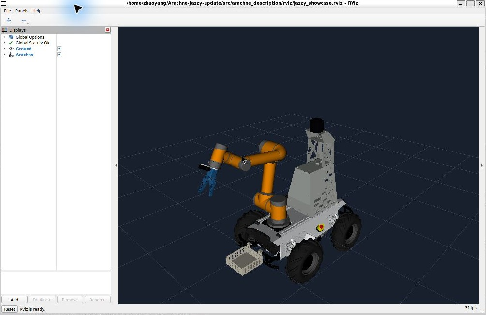
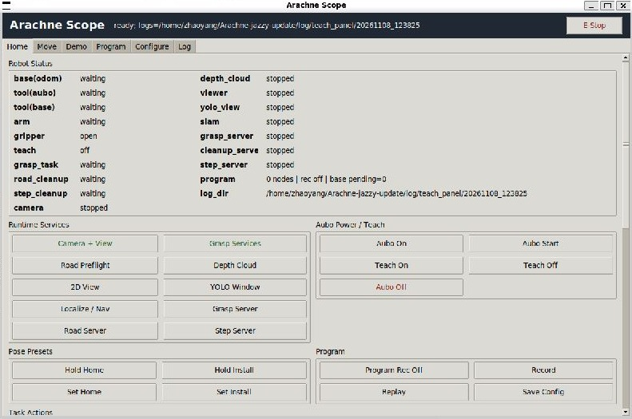

# Arachne 具臂移动机器人


[](https://docs.ros.org/en/jazzy/)
[](https://releases.ubuntu.com/24.04/)


## 演示


Arachne main is a ROS 2 Jazzy workspace for a Scout 2.0 mobile base, Aubo i5 arm,
MS42DC gripper, Gemini335 RGB-D camera, and C16 lidar.

`main` integrates the latest committed `jetson` features for Ubuntu 24.04 / WSL2;
`jetson` remains the Ubuntu 22.04 / ROS 2 Humble hardware branch.

## Jazzy / WSL2 model preview



Actual Jazzy / WSL2 runtime capture: Scout base, Aubo arm, gripper, front basket
and sensor rack. This is a default-pose model preview, not a hardware execution.

On the tested WSL2 machine, Fast DDS discovered the model publisher but did not
deliver its transient description/static transforms. Cyclone DDS restored the model:

```bash
sudo apt install ros-jazzy-rmw-cyclonedds-cpp
source scripts/env/arachne_env.sh
export RMW_IMPLEMENTATION=rmw_cyclonedds_cpp
source install/setup.bash
ros2 launch arachne_operator teach_visualization.launch.py aubo_sdk_fallback_enabled:=false
```

For the dark showcase view, append
`rviz_config:=$(ros2 pkg prefix --share arachne_description)/rviz/jazzy_showcase.rviz`.

This preview uses the default model pose without contacting the arm SDK. For the
operator UI without automatic hardware/service startup:

```bash
ros2 launch arachne_operator teach_panel.launch.py with_real_bringup:=false with_camera:=false autostart_managed_processes:=false
```



The panel exposes pose presets, recording/replay, camera, navigation and grasp
services. Hardware status is intentionally waiting in this offline capture.

Validated on Ubuntu 24.04 / Jazzy: 13-package workspace build, offline checks,
entrypoints, teach-panel headless check, grasp/road-cleanup dry runs, and the two
live GUI views above. Gazebo packages were skipped because their build dependencies
are absent on this machine. Real hardware operation was not tested.

## Build

```bash
source scripts/env/arachne_env.sh
./scripts/build/build_workspace.sh
source install/setup.bash
```

Build logs are written under `log/build/`.

## Run The Full Operator

Use this as the normal entrypoint:

```bash
source scripts/env/arachne_env.sh
source install/setup.bash
ros2 launch arachne_operator teach_panel.launch.py
```

This starts the operator panel, RViz/model view, camera controls, task servers,
and real hardware bringup. Start/stop camera, SLAM, grasp, road cleanup, gripper,
base, and arm actions from the panel.

The new `Step Demo` button runs a simplified road-cleanup flow: observe once,
stop detection, move the base forward by small steps, re-detect, then trigger
one or more normal grasp attempts when the trash is close enough.

## Maintenance Checks

These are for development only, not field operation:

```bash
ros2 run arachne_operator teach_panel --headless-check
ros2 run arachne_operator grasp_task_server --dry-run-check
ros2 run arachne_operator road_cleanup_task_server --dry-run-check
ros2 run arachne_operator arachne check entrypoints
ros2 run arachne_operator arachne check offline
```

## Safety

Dry-run and headless checks never start real motion. Real motion paths must keep
their existing explicit confirmation parameters and field safety checks.

## Layout

| Path                      | Purpose                                           |
| ------------------------- | ------------------------------------------------- |
| `src/arachne_operator`    | Teach panel and task servers                      |
| `src/arachne_hardware`    | Real hardware drivers/actions                     |
| `src/arachne_description` | Robot model and RViz assets                       |
| `src/arachne_sensors`     | Gemini335 camera nodes                            |
| `src/arachne_nav`         | Navigation starter configs                        |
| `scripts`                 | Bootstrap, install, and field helper scripts only |
| `third_party`             | Vendor packages required for builds               |
| `yolo_workspace`          | Local model weights and datasets                  |

## Deprecated

Runtime shell wrappers under `scripts/` are not stable interfaces. Use
`ros2 launch arachne_operator teach_panel.launch.py` for normal operation.
