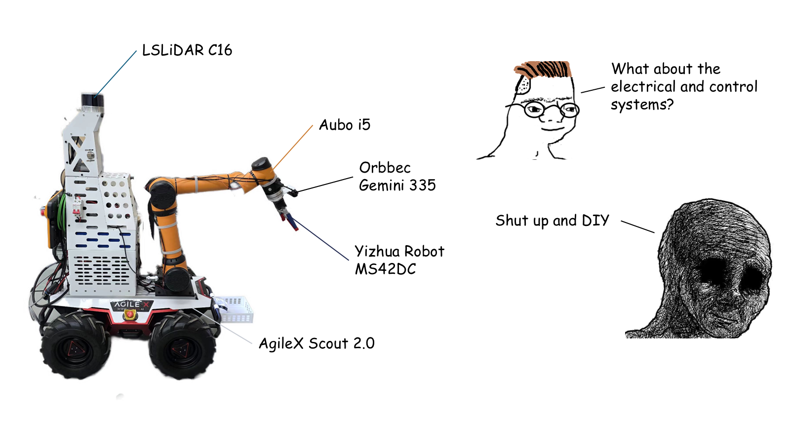
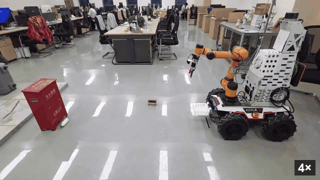

# Arachne 具臂移动机器人


[](https://docs.ros.org/en/humble/)
[](https://releases.ubuntu.com/22.04/)


## 演示


Arachne is a ROS 2 Humble workspace for a Scout 2.0 mobile base, Aubo i5 arm,
MS42DC gripper, Gemini335 RGB-D camera, and C16 lidar.

## 版本选择 / Branches

| 分支 | ROS / 系统 | 推荐用途 |
| --- | --- | --- |
| [main](https://github.com/zay002/Arachne-armed-mobile-robot/tree/main) | ROS 2 Jazzy / Ubuntu 24.04 | 本机与 WSL2 开发、模型展示、离线验证 |
| [jetson](https://github.com/zay002/Arachne-armed-mobile-robot/tree/jetson) | ROS 2 Humble / Ubuntu 22.04 | Jetson 真机集成、示教与现场任务 |

main 已合入本次更新前 jetson 的已提交功能；后续提交仍需同步并重新验证。
**WSL2 用户推荐搭配 [hurry-porter](https://github.com/zay002/hurry-porter)**，
快速扫描、诊断并穿透 Windows USB 串口、USB-CAN 和手柄到 WSL2。
详细版本差异、验证边界和 USB 穿透步骤见 [版本与 WSL2 接入指南](docs/versions-and-wsl2.md)。

## Build

```bash
source scripts/env/arachne_env.sh
./scripts/build/build_workspace.sh
source install/setup.bash
```

Build logs are written under `log/build/`.

## Run The Full Operator

Use this as the normal entrypoint:

```bash
source scripts/env/arachne_env.sh
source install/setup.bash
ros2 launch arachne_operator teach_panel.launch.py
```

This starts the operator panel, RViz/model view, camera controls, task servers,
and real hardware bringup. Start/stop camera, SLAM, grasp, road cleanup, gripper,
base, and arm actions from the panel.

The new `Step Demo` button runs a simplified road-cleanup flow: observe once,
stop detection, move the base forward by small steps, re-detect, then trigger
one or more normal grasp attempts when the trash is close enough.

## Maintenance Checks

These are for development only, not field operation:

```bash
ros2 run arachne_operator teach_panel --headless-check
ros2 run arachne_operator grasp_task_server --dry-run-check
ros2 run arachne_operator road_cleanup_task_server --dry-run-check
ros2 run arachne_operator arachne check entrypoints
ros2 run arachne_operator arachne check offline
```

## Safety

Dry-run and headless checks never start real motion. Real motion paths must keep
their existing explicit confirmation parameters and field safety checks.

## Layout

| Path                      | Purpose                                           |
| ------------------------- | ------------------------------------------------- |
| `src/arachne_operator`    | Teach panel and task servers                      |
| `src/arachne_hardware`    | Real hardware drivers/actions                     |
| `src/arachne_description` | Robot model and RViz assets                       |
| `src/arachne_sensors`     | Gemini335 camera nodes                            |
| `src/arachne_nav`         | Navigation starter configs                        |
| `scripts`                 | Bootstrap, install, and field helper scripts only |
| `third_party`             | Vendor packages required for builds               |
| `yolo_workspace`          | Local model weights and datasets                  |

## Deprecated

Runtime shell wrappers under `scripts/` are not stable interfaces. Use
`ros2 launch arachne_operator teach_panel.launch.py` for normal operation.
